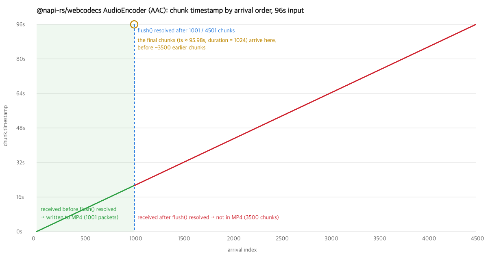

# @napi-rs/webcodecs AudioEncoder: `flush()` resolves before all chunks are delivered

With `@napi-rs/webcodecs` 1.4.2, `AudioEncoder.flush()` (AAC) resolves while most encoded chunks have not yet reached the `output` callback. A muxer that finalizes right after `await flush()` — mediabunny does — writes only the chunks that arrived so far.



96 s of synthetic stereo noise at 48 kHz:

| | value |
| --- | --- |
| chunks delivered in total | 4501 |
| chunks delivered when `flush()` resolved | 1001 |
| packets in the resulting MP4 | 1001 (≈ 21.3 s of audio) |

Two more defects are visible in the same run:

- The final chunks (timestamp ≈ 95.98 s) are delivered right before `flush()` resolves, ahead of ~3500 earlier chunks, so the output order is not monotonic.
- The last two chunks share the same `timestamp` (95978666), and their `duration` is `1024`: a sample count where microseconds are expected (other chunks have `21333`).

## Reproduce

```sh
npm install
node repro.mjs 96   # encodes 96 s via mediabunny, writes result.json
node plot.mjs       # draws arrival-order.png from result.json
```

`repro.mjs` wraps the encoder's `output` callback to record the arrival order and the number of chunks received when `flush()` resolves. Then it reads the MP4 back with mediabunny and counts the packets.

Calling `encode()` in a tight loop without yielding to the event loop does not reproduce the truncation (all chunks arrive before `flush()` resolves). The last-chunk timestamp/duration defect appears either way.

## Environment

- `@napi-rs/webcodecs` 1.4.2, mediabunny 1.61.3
- Node.js 24.18.0, macOS (darwin-arm64)
