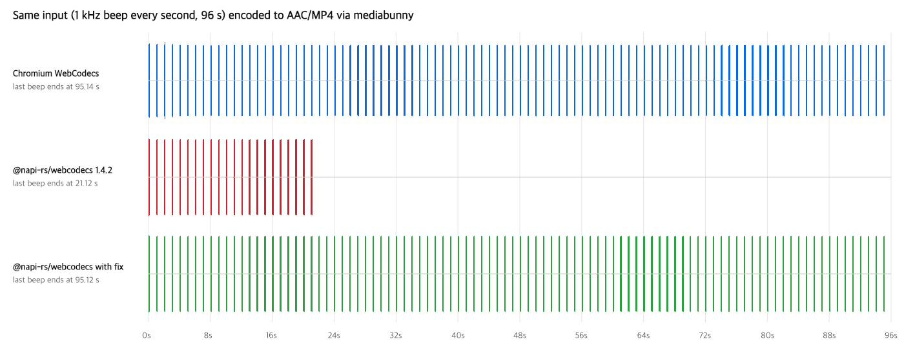

# @napi-rs/webcodecs AudioEncoder: `flush()` resolves before all chunks are delivered

With `@napi-rs/webcodecs` 1.4.2, `AudioEncoder.flush()` (AAC) resolves while most encoded chunks have not yet reached the `output` callback. A muxer that finalizes right after `await flush()` (mediabunny does) writes only the chunks that arrived so far.

The same input, a 1 kHz beep every second for 96 s, is encoded to AAC/MP4 through mediabunny in Chromium and in Node with `@napi-rs/webcodecs`. The Node file stops after about 21 s:



| | Chromium | @napi-rs/webcodecs 1.4.2 |
| --- | --- | --- |
| packets in the MP4 | 4503 | 1001 |
| chunks delivered when `flush()` resolved | — | 1001 of 4501 |

Two more defects show up in the same encoder. The final chunks (`timestamp` `95978666`) are delivered right before `flush()` resolves, ahead of ~3500 earlier chunks. They also share one `timestamp`, and their `duration` is `1024`, a sample count where microseconds are expected.

The third lane is the same Node export built from [a branch with a fix](https://github.com/sor4chi/webcodecs-node/tree/fix/audio-encoder-flush-delivery).

## Reproduce

```sh
npm install
node export-chromium.mjs 96            # chromium.mp4 (set CHROMIUM_PATH to use a specific Chromium)
node export-node.mjs 96 node.mp4       # node.mp4, prints delivery counts
node waveform.mjs                      # waveform.png (needs ffmpeg)
```

To add the fixed lane, build the fix branch and run `WEBCODECS_PATH=<path to its index.js> node export-node.mjs 96 node-patched.mp4`.

`export-node.mjs` wraps the encoder's `output` callback to count chunks and records how many had arrived when `flush()` resolved. mediabunny waits for `dequeue` whenever `encodeQueueSize >= 4`, so `encode()` calls are interleaved with yields to the event loop. Calling `encode()` in a tight loop without yielding does not reproduce the truncation.

## Environment

- `@napi-rs/webcodecs` 1.4.2, mediabunny 1.61.3
- Chromium 153 (headless, Playwright), Node.js 24.18.0, ffmpeg 8, macOS (darwin-arm64)
